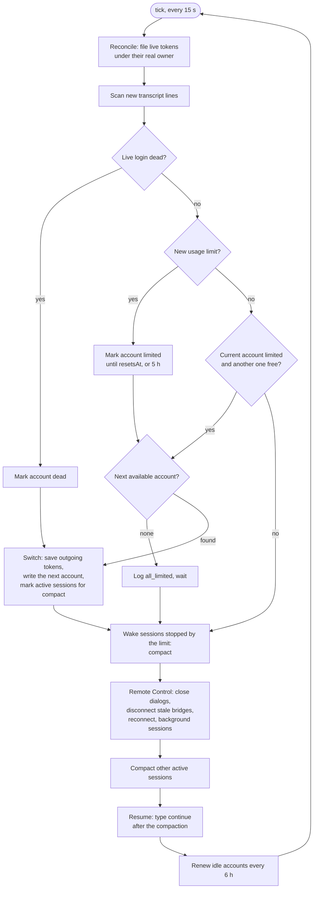
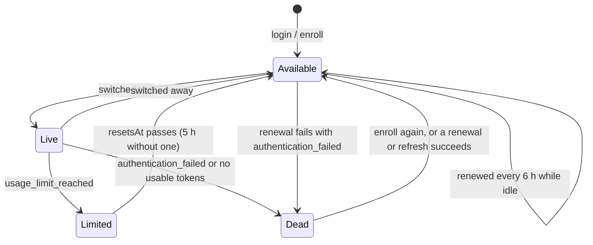

# claude-rotate

Switches Claude Code to another of your accounts when one hits its usage limit, wakes the sessions the limit stopped, and keeps Remote Control alive across the switch.

It is a single Python file with no dependencies. It runs on Linux as a background watcher, usually a systemd user service.

> **Read your plan's terms first.** claude-rotate only switches between accounts that you own and have logged into yourself. Anthropic's terms for your plan decide whether you may use several subscriptions this way. Following them is your responsibility.

- [The problem](#the-problem)
- [How it works](#how-it-works)
- [What you need to make it work](#what-you-need-to-make-it-work)
- [Troubleshooting](#troubleshooting)
- [Reference](#reference)

## The problem

You have several Claude subscriptions: personal and work, or more than one seat. A usage limit still stops you cold:

- Every session on that config dir halts with `You've hit your limit · resets 9pm`.
- To go on, you `/logout`, `/login` with another account in a browser, then type "continue" in each session by hand.
- Copying credential files between accounts by hand is fragile. Refresh tokens **rotate**: each refresh revokes the previous token. Restore a stale copy, or file a refreshed token under the wrong account, and that account is logged out.
- An account you haven't used for a while can expire on its own. It then fails exactly when you rotate onto it.

claude-rotate does all of this for you. It keeps one token slot per account (the **vault**), notices the limit in Claude Code's transcripts, writes the next account into the config dir, and types the follow-up commands into your sessions.

## How it works

### One tick

`claude-rotate watch` runs a tick every 15 seconds (`--interval`). For each watched config dir, in this order:

1. **Reconcile.** If the live tokens in `.credentials.json` changed, ask the OAuth profile endpoint who owns them and file them in that account's slot. Put the right account back if they belong to another one.
2. **Scan.** Read the transcript lines appended since the last tick. Look for usage-limit errors, login errors and hand disconnects of Remote Control.
3. **Drop a dead login.** If the live login has no usable tokens, or a session reported an expired login, mark the account dead and switch.
4. **Switch on a limit**, or **recover**: if the current account is still limited and another one is free, switch to it.
5. **Wake** the sessions the limit stopped: `/compact`, then "continue".
6. **Remote Control**: close leftover dialogs, disconnect bridges owned by the old account, reconnect `/remote-control`, reconnect background sessions.
7. **Compact** the other sessions that were active at the switch.
8. **Resume**: tell woken sessions to continue once their compaction is done.

After every config dir, it **renews** idle accounts that are due (every 6 hours each).



### Vault and token ownership

The vault holds one file per account: its tokens (`claudeAiOauth`) and its account info (`oauthAccount`).

Claude Code refreshes tokens on its own and writes them to `<config-dir>/.credentials.json`. Each refresh revokes the previous refresh token. So the vault must always hold the newest token of every account, filed under the right account.

On every tick, when the live tokens differ from the vault copy, `reconcile` asks `https://api.anthropic.com/api/oauth/profile` which account owns the access token:

- **The expected account owns it** (a session refreshed it): store it in that slot (`vault_refreshed`).
- **Another enrolled account owns it** (a session still on the old account wrote its token): store it in that account's slot, then write the expected account's tokens back (`guard_restored`).
- **The owner is not enrolled**: write nothing (`owner_not_enrolled`).
- **The owner can't be resolved**, for example with no network: write nothing (`owner_unresolved`). It never guesses.

For 120 seconds after a switch, a **guard** also puts `oauthAccount` back if a session overwrites it (`guard_account_restored`). While a guard is active the loop ticks every 5 seconds.

### Limit detection

Claude Code writes a synthetic error entry to the session transcript when a request fails. claude-rotate tails every transcript under `<config-dir>/projects/**/*.jsonl`, subagent transcripts included.

It reads the entry's structured fields, never its text:

- `apiError == "usage_limit_reached"` is a usage limit. `quotaLimits.resetsAt` is when it resets.
- `error == "authentication_failed"` is an expired login.

A reworded or translated message does not break detection. A short-lived 429 is not a quota limit and is ignored.

The account is marked limited until `resetsAt`, or for 5 hours if the entry has none. Limit and login errors dated within 90 seconds after a switch are requests that were already in flight; they are ignored (`limit_inflight_ignored`).

When the watcher starts, or a config dir is added, it skips everything already in the transcripts. It reacts only to new lines.

### Switching

A switch picks the next account in `order` (round-robin), skipping accounts that are limited, dead, or have no usable tokens. Then it:

1. Saves the outgoing account's live tokens to its slot.
2. Writes the target's `claudeAiOauth` into `<config-dir>/.credentials.json`.
3. Writes the target's `oauthAccount` into `.claude.json`. For the default `~/.claude` that file is `~/.claude.json`; for any other config dir it is `<config-dir>/.claude.json`.
4. Every other key in those files is left alone.

The switch applies to the whole config dir. Every session on it moves to the new account at its next request.

When every account is limited, it logs `all_limited` with the earliest reset and waits. As soon as one is free, `recover` switches to it and the sessions are woken.

### Keeping tokens fresh

An account that sits unused can expire. Every 6 hours, each enrolled account that is not live on a watched config dir, not limited and not dead gets a one-word `claude -p` call. The call runs in a throwaway config dir, so the tokens refresh there and are copied into the vault. Your real config dirs are not touched.

- Success: `renewed` with the new expiry.
- The throwaway transcript shows `error == "authentication_failed"`: the account is marked dead (`account_dead`).
- Anything else (timeout, no `claude` binary, network): `renew_error`, retried at the next due time.

### Waking stopped sessions

A session is stopped by the limit when its last turn is the usage-limit error. Once the config dir is on a healthy account, and either the switch came after the error or the limit's reset time has passed, claude-rotate:

1. Types `/compact` into the session, asking the summary to keep what it was doing, what is done, what is pending and the next step (`woke`).
2. Waits for a `compact_boundary` entry in the transcript.
3. Types "Account rotated (claude-rotate) and the conversation compacted. Continue where you stopped." (`continued`).

If the compaction does not show within 10 minutes, it logs `compact_missing` and sends the continue anyway.

### Compacting active sessions

A new account means a cold cache, and with Remote Control a new remote session with no history. So every interactive session that was **active** at the switch also gets `/compact` (`compact_asked`), without a continue. Active means busy, or its last turn ended less than 30 minutes before. Sessions idle for longer are left alone.

A session is compacted only when all of these hold:

- its status is `idle` or `shell` (a busy session waits for its turn to end);
- its input box is empty (a draft or a dialog makes it wait);
- with Remote Control on, it has a new bridge (see below).

The list of sessions owed a compaction lives in memory. Restarting the watcher drops it.

### Remote Control

This part runs only for config dirs whose `settings.json` sets `"remoteControlAtStartup": true`.

A switch changes the claude.ai account, so Claude Code drops every session's Remote Control bridge ("signed-in claude.ai account or organization changed"). claude-rotate brings each one back under the new account, with the session's name.

**Settle time.** For about 10 seconds after a switch, `/remote-control` only opens a "Remote Control isn't connected" dialog. So none of the Remote Control steps send anything in the first 20 seconds.

**Dismiss dialogs.** A Remote Control dialog ("Esc to continue") still open on the next tick is closed with Escape (`rc_dialog_closed`, with `dialogs=connected` or `not-connected`).

**Disconnect bridges owned by the old account.** Some Claude Code versions keep their bridge across the switch, so the session stays listed under the old account. Each `bridge-session` entry in the transcript names the account that registered it (`ownerAccountUuid`). When a free session's bridge belongs to another account than the config dir's, claude-rotate types `/remote-control`, moves the menu cursor up to "Disconnect this session" and presses Enter (`rc_stale_disconnected`). If the option doesn't show, it closes the menu (`rc_disconnect_failed`). A bridge whose owner no entry names is read again every 5 minutes. Until then, a bridge the session already had when claude-rotate switched counts as the old account's and gets one disconnect try.

**Reconnect.** `/remote-control <title>` is typed into each interactive session with no bridge, when:

- its status is `idle`, `shell` or `busy` (a session waiting on a permission prompt is skipped);
- its input box is empty (your draft is never touched);
- its bridge has been missing for 60 seconds in a row. Claude Code leaves `bridgeSessionId` out of `sessions/<pid>.json` while it brings a bridge up, and typing the command then only opens a dialog.

A busy session connects at once and keeps working. It gets no Escape, which would interrupt its turn. The log says `rc_reconnected`.

Five seconds later each typed session is checked for a dialog:

- `rc_already_on dialog=connected`: the session is already connected. It is not typed into again until its bridge shows in the registry.
- `rc_already_on dialog=not-connected`, or no bridge yet: retried after 30 seconds, then twice as long each time, up to 30 minutes.

**Hand disconnects.** If you choose "Disconnect this session" yourself, Claude Code writes "Remote Control disconnected." to the transcript. claude-rotate logs `rc_disconnected_by_hand` and leaves that session alone until it has a bridge again. Its own disconnects don't count. A disconnect made while the watcher was stopped is not seen.

**Restart as a last resort.** If an earlier `/remote-control` was sent, the session is free, its parent process is a shell, and its screen shows "requires a claude.ai subscription" or "Unknown command: /remote-control", claude-rotate types `/exit` and then `claude --resume <session-id>` in the same pane, so the session reloads its login (`rc_restarted`). At most once per pane every 30 minutes.

**Session names.** The command carries the session's title, so the remote session keeps the same name. That is the name you gave it (`/rename`, `--name`), else the latest title Claude Code generated (its `ai-title` entry). The name Claude Code derives from the directory (for example `myproject-81`) is never used. Titles are cleaned: control characters removed, whitespace collapsed, cut to 80 characters.

**Background sessions.** A session sent to the background (`/bg`, `claude --bg`) runs in the Claude Code daemon with no terminal of its own. The daemon keeps its bridge in `<config-dir>/jobs/<id>/state.json`. When that bridge is missing or `bridgeOwnerAccountUuid` is another account, claude-rotate types `/remote-control <name>` into the `claude agents` view that has the session open. It finds the view by the session name on the separator line above the input box (`rc_reconnected_bg`). A background session not open in any agent view can't be reached, and it is never compacted.

**Order with wake and compact.** With Remote Control on, wake and compact wait for each session's new bridge, so the compacted summary is the first thing the new remote session shows. The registry still shows the old bridge for a few seconds after the switch; that one doesn't count.

### Reaching sessions: tmux and Orca

claude-rotate finds sessions with `pgrep -x claude`. It reads each process's environment from `/proc/<pid>/environ`:

- `CLAUDE_CONFIG_DIR` (default `~/.claude`) says which config dir the session belongs to.
- `TMUX_PANE` (and the socket from `TMUX`): the session is in **tmux**. It types with `tmux send-keys` and reads the screen with `tmux capture-pane -p -e`. This wins if both are set.
- `ORCA_TERMINAL_HANDLE` **and** `ORCA_CLI_COMMAND`: the session runs natively in an **Orca** terminal. It types with `orca terminal send --text` and reads with `orca terminal read --screen`, using the CLI the variable names. Orca returns the input box separately as `draft`. claude-rotate puts it back on the boxed `❯` line (the last `❯` line right under a `─` border), so draft checks work as in tmux. Menu `❯` cursor lines are left alone. These sessions show as `pane=orca:<handle>` in the log.

All typing goes into an empty input box only:

1. Type the text. No Escape first: it doesn't clear the box, the terminal can merge it with the first letter into an Alt key, and it would interrupt a busy session.
2. Press Enter once the text shows in the box (polled every 0.5 seconds for up to 3 seconds).
3. While the text stays in the box, press Enter again, up to 4 times.
4. If it never shows or never leaves, empty the box line by line (Ctrl+U, Backspace) and log `type_failed`. It is never left behind as a draft for you to send by accident.

**Sessions with neither** (a plain terminal, an IDE, the desktop app) can't be typed into. For them, the switch itself still works: they share the config dir's credentials, so their next request runs on the new account, and token reconcile, limit detection and renewal work as usual. Nothing wakes, compacts or reconnects them. Type `continue` yourself after a switch, and run `/remote-control` yourself if you use it.

### The state of an account



`Live` is the account a config dir is on. A limited or dead account is skipped when choosing the next one.

## What you need to make it work

### 1. System requirements

- **Linux.** It reads `/proc` to find `claude` processes and their config dirs.
- **Python 3.10+** and **`pgrep`** (procps).
- **tmux** or **Orca** for the sessions you want woken (see [Reaching sessions](#reaching-sessions-tmux-and-orca)).
- **Claude Code logged in with a claude.ai subscription (OAuth).** It stores credentials in `<config-dir>/.credentials.json`. API-key logins have nothing to rotate.
- **Network access to `api.anthropic.com`** for the ownership check.

System packages (`pipx` is only needed for the pipx install):

```bash
# Debian / Ubuntu
sudo apt install python3 tmux procps pipx

# Fedora
sudo dnf install python3 tmux procps-ng pipx

# Arch
sudo pacman -S python tmux procps-ng python-pipx
```

macOS and Windows are not supported. On macOS, Claude Code keeps credentials in the Keychain, not in `.credentials.json`.

### 2. Install

Copy the single file onto your `PATH`:

```bash
git clone https://github.com/DBC-Juanma/claude-rotate
install -m 755 claude-rotate/claude_rotate.py ~/.local/bin/claude-rotate
```

Or install it as a tool:

```bash
uv tool install git+https://github.com/DBC-Juanma/claude-rotate
# or
pipx install git+https://github.com/DBC-Juanma/claude-rotate
```

Then add the systemd user unit. It is `contrib/claude-rotate.service`:

```ini
[Unit]
Description=Rotate Claude Code logins across accounts on usage limits

[Service]
Type=simple
ExecStart=%h/.local/bin/claude-rotate watch
Restart=always
RestartSec=5

[Install]
WantedBy=default.target
```

```bash
mkdir -p ~/.config/systemd/user
cp claude-rotate/contrib/claude-rotate.service ~/.config/systemd/user/
```

`ExecStart` points at `~/.local/bin/claude-rotate`, where the copy, `uv tool install` and pipx put it. Edit it if yours is elsewhere.

The service calls `claude`, `tmux` and `pgrep` by name. They must be on the service's `PATH`. Check with `systemctl --user show-environment`. If `claude` lives in `~/.local/bin` and that is missing, add a line such as `Environment=PATH=%h/.local/bin:/usr/local/bin:/usr/bin:/bin` under `[Service]`.

Don't start the service yet. Enroll the accounts first.

### 3. Enroll each account

Each account needs a vault slot. `enroll` checks with the OAuth profile endpoint that the token really belongs to the account, and refuses otherwise. Accounts rotate in the order you enroll them.

**Option A: `claude-rotate login`** (recommended for every account you are not using right now).

```bash
claude-rotate login                         # opens the browser login
claude-rotate login --email you@example.com # pre-fills the email
```

It logs in inside a throwaway config dir, enrolls the account and deletes the dir. No live session sees that login.

**Option B: `/login` + `enroll` inside a watched config dir.** In a Claude Code session on a config dir claude-rotate watches (`~/.claude` by default), run `/login` with the account, then:

```
! claude-rotate enroll
```

`enroll` reads the config dir from `$CLAUDE_CONFIG_DIR` (default `~/.claude`), or from `--config-dir`. The config dir is now on that account, the same state a rotation leaves it in. The account you are already logged into in `~/.claude` can be enrolled the same way, with `claude-rotate enroll`.

**Never enroll from a config dir that claude-rotate doesn't watch while sessions run in it.** The watcher only knows which accounts are live from the watched config dirs. To it, that account looks idle, so every 6 hours it renews the account in a throwaway dir. The renewal rotates the refresh token, which revokes the copy the unwatched dir holds, and those sessions are logged out.

**Never enroll the same login twice.** Two slots holding the same refresh-token family revoke each other the first time either refreshes. Always enroll from a fresh login.

### 4. Configure

The first command creates `~/.config/claude-rotate/config.json` (or under `$XDG_CONFIG_HOME`):

```json
{
  "config_dirs": ["/home/you/.claude"],
  "order": ["personal@example.com", "work@example.com"]
}
```

- `config_dirs`: the config dirs to watch. Add each `CLAUDE_CONFIG_DIR` you run sessions on.
- `order`: the rotation order. `enroll` appends to it. Reorder it to change the rotation.

Each config dir switches independently. To keep accounts apart, use separate config dirs and list each one.

The watcher reads `config.json` on every tick, so edits take effect without a restart. A newly added config dir starts from its current transcripts.

### 5. Turn on Remote Control reconnects (optional)

If you use Remote Control, add this to each config dir's `settings.json` (for example `~/.claude/settings.json`):

```json
{
  "remoteControlAtStartup": true
}
```

New sessions then start with Remote Control on, and claude-rotate brings bridges back after a switch. Without it, claude-rotate does no Remote Control work at all for that config dir.

### 6. Start the watcher

```bash
systemctl --user daemon-reload
systemctl --user enable --now claude-rotate
journalctl --user -u claude-rotate -f
```

The first line is `watch_start interval=15`.

### 7. Run sessions inside tmux or Orca

Start Claude Code in a tmux pane or in an Orca terminal. Sessions elsewhere still switch accounts, but are not woken (see [Reaching sessions](#reaching-sessions-tmux-and-orca)).

### 8. Verify

```bash
claude-rotate status   # never prints tokens
claude-rotate check    # renews every idle account now; exit code 1 if any is dead or failing
```

`status` prints the account and subscription type per config dir, then the state of every account:

```
config dirs:
  /home/you/.claude: personal@example.com max
accounts:
  personal@example.com: available; token expires 2026-01-06 05:10:42
  work@example.com: limited until 2026-01-05 23:00:00; token expires 2026-01-06 04:58:10
  old@example.com: DEAD since 2026-01-04 10:00:00: <reason>; token expires 2026-01-03 09:00:00
```

When a limit hits, the journal shows a sequence like:

```
... limit_hit email=personal@example.com config_dir=/home/you/.claude until=2026-01-05 23:00:00
... switch reason=limit config_dir=/home/you/.claude from=personal@example.com to=work@example.com
... rc_reconnected config_dir=/home/you/.claude panes=%3,orca:term-7
... woke config_dir=/home/you/.claude panes=%3
... compact_asked config_dir=/home/you/.claude panes=orca:term-7
... continued config_dir=/home/you/.claude panes=%3
```

- `limit_hit`: a usage limit was found; `fallback=5h` means the entry had no reset time.
- `switch`: the config dir moved to the next account.
- `rc_reconnected`: `/remote-control` was typed into these sessions.
- `woke` / `continued`: stopped sessions were compacted, then told to continue.
- `compact_asked`: other active sessions were compacted.
- `type_failed`: text didn't submit in that session and the box was cleared (see [Troubleshooting](#troubleshooting)).

All events are listed under [Log events](#log-events).

## Troubleshooting

**A session shows "Login expired" or the log says `account_dead`.** The account's tokens were rejected. claude-rotate marks it `DEAD` in `status`, skips it from then on, and switches the config dir off it. Fix: log in again with `claude-rotate login` (or `/login` + `enroll` in a watched dir). Enrolling clears the dead mark. `claude-rotate check` also clears it if the stored tokens turn out to work. Common causes: the account was enrolled from an unwatched config dir that still has sessions, the same login was enrolled twice, or the account sat unused with the watcher stopped.

**`type_failed` in the log.** The text never showed in the input box, or Enter didn't submit it after 4 tries. The box was emptied so nothing is left as a draft. Common causes: the session was slow to draw, a dialog took the keys, or you typed at the same moment. A Remote Control reconnect is retried with its usual backoff. A `/compact` is not retried: for a session stopped by the limit, the continue still goes out after 10 minutes (`compact_missing`); for other active sessions, type `/compact` yourself if you want it. For Orca sessions, check that `orca terminal read` works from the service's environment.

**A session has no Remote Control after a switch.** This is often deliberate:

- It waits for 20 seconds after the switch, then for the bridge to be missing 60 seconds in a row.
- It is skipped while its input box holds a draft, and while it waits on a permission prompt or another non-idle status. Busy sessions are reconnected.
- After `rc_already_on`, it waits for the bridge to show in the registry. Retries back off up to 30 minutes.
- You disconnected it by hand (`rc_disconnected_by_hand`). Run `/remote-control` yourself.
- It isn't in tmux or Orca, or it is a background session not open in any `claude agents` view.
- `remoteControlAtStartup` isn't set in that config dir's `settings.json`.

Stale-bridge disconnects and compactions also need a free session (`idle` or `shell`) and an empty box.

**A session was never compacted or continued.** With Remote Control on, wake and compact wait for the session's new bridge. If the bridge never comes back, they never run. Get the bridge back (see above) or type the commands yourself. Pending compactions are also lost when the watcher restarts.

**`renew_error`.** The renewal failed for a reason other than a rejected login: timeout (180 seconds), network, or `claude` not found on the service's `PATH`. It is retried at the next due time. Run `claude-rotate check` to retry now and see the result per account.

**`owner_unresolved` or `owner_not_enrolled`.** The live token's owner couldn't be checked (no network) or belongs to an account not in the vault. Nothing is written. Enroll the account if it should rotate.

**`all_limited`.** Every account is limited. The log shows the earliest reset. The watcher switches as soon as one is free.

**`limit_inflight_ignored`.** Limit errors dated within 90 seconds after a switch. They come from requests sent before the switch and are expected.

**`rc_restart_failed reason=session did not exit`.** The `/exit` before a `claude --resume` didn't end the session within 30 seconds. Restart it yourself.

## Reference

### Commands

| Command | What it does |
|---|---|
| `claude-rotate login [--email EMAIL]` | Log in to an account in a throwaway config dir and enroll it |
| `claude-rotate enroll [--config-dir DIR]` | Snapshot the account logged in to `DIR` (default `$CLAUDE_CONFIG_DIR` or `~/.claude`) into the vault, after checking the token's owner |
| `claude-rotate status` | Account per watched config dir; for every account: available / limited until / dead, and token expiry. Never prints tokens |
| `claude-rotate check` | Renew every idle account now, including limited and dead ones; exit code 1 if any fails |
| `claude-rotate use EMAIL [--config-dir DIR]` | Switch a config dir to an account by hand. It only switches; it doesn't wake or compact sessions |
| `claude-rotate watch [--interval SECONDS]` | The watch loop (default 15 seconds; 5 seconds while a post-switch guard is active) |

### Configuration and state files

State lives in `$XDG_CONFIG_HOME/claude-rotate` (default `~/.config/claude-rotate`). The directory is mode 0700 and every file is 0600.

| File | Contents |
|---|---|
| `config.json` | `config_dirs`: the config dirs to watch; `order`: the rotation order of enrolled emails |
| `accounts/<email>.json` | the vault: tokens (`claudeAiOauth`) and account info (`oauthAccount`) per account |
| `state.json` | `limited` (limited-until times), `dead`, `renewed` (last renewal), `switched_at`, `guards` (120-second post-switch guards) |
| `lock` | inter-process lock shared by the watcher and the commands |

Files claude-rotate reads or writes in each config dir:

| File | Use |
|---|---|
| `.credentials.json` | `claudeAiOauth` is read and replaced; other keys are kept |
| `~/.claude.json` (default dir) or `<config-dir>/.claude.json` | `oauthAccount` is read and replaced; other keys are kept |
| `settings.json` | `remoteControlAtStartup` is read |
| `projects/**/*.jsonl` | transcripts: limit and login errors, `compact_boundary`, `bridge-session`, `ai-title`, hand disconnects |
| `sessions/<pid>.json` | session registry: `status`, `kind`, `sessionId`, `bridgeSessionId`, `name`, `nameSource` |
| `jobs/<id>/state.json` | background sessions: `bridgeSessionId`, `bridgeOwnerAccountUuid`, `name` |

### Timings

| What | Value |
|---|---|
| Tick | 15 s (5 s during a guard) |
| Post-switch guard | 120 s |
| In-flight grace for limit errors after a switch | 90 s |
| Limit without `resetsAt` | 5 h |
| Idle-account renewal | every 6 h, 180 s timeout |
| "Active" session for compaction | busy, or last turn within 30 min |
| Wait for compaction before continuing anyway | 10 min |
| Remote Control settle after a switch | 20 s |
| Bridge missing before reconnecting | 60 s |
| Reconnect retry | 30 s, doubling up to 30 min |
| Re-read an unknown bridge owner | 5 min |
| `claude --resume` restart cooldown per pane | 30 min |
| Orca CLI call timeout | 20 s |

### Log events

Each line is `YYYY-MM-DD HH:MM:SS <event> key=value ...`.

| Event | Meaning |
|---|---|
| `watch_start` | the watcher started |
| `enroll` | an account was stored in the vault |
| `switch` | a config dir moved to another account (`reason=limit` or `use`) |
| `limit_hit` | a usage limit was found; `fallback=5h` when it had no reset time |
| `limit_inflight_ignored` | limit errors within 90 s after a switch were ignored |
| `all_limited` | no account is available; shows the earliest reset |
| `account_dead` | an account's login was rejected or its slot has no usable tokens |
| `renewed` / `renew_error` | idle-account renewal succeeded / failed for a non-login reason |
| `vault_refreshed` | a refreshed live token was stored in its own slot |
| `guard_restored` | a token of another account was filed under its owner and the right one put back |
| `guard_account_restored` | `oauthAccount` was put back during the post-switch guard |
| `owner_unresolved` / `owner_not_enrolled` | a live token's owner couldn't be checked / isn't enrolled; nothing written |
| `woke` | `/compact` typed into sessions stopped by the limit |
| `continued` | "continue" typed after the compaction |
| `compact_missing` | no compaction 10 min after `/compact`; continued anyway |
| `compact_asked` | `/compact` typed into other active sessions |
| `rc_reconnected` / `rc_reconnected_bg` | `/remote-control` typed into sessions / agent views of background sessions |
| `rc_already_on` | `/remote-control` answered with a dialog (`dialog=connected` or `not-connected`) |
| `rc_dialog_closed` | leftover Remote Control dialogs closed |
| `rc_stale_disconnected` / `rc_disconnect_failed` | bridges of the old account disconnected / menu option not found |
| `rc_disconnected_by_hand` | you disconnected Remote Control yourself; the session is left alone |
| `rc_restarted` / `rc_restart_failed` | a session was restarted with `claude --resume` / didn't exit |
| `type_failed` | typed text didn't submit; the input box was cleared |

### Caveats

- **The switch applies to the whole config dir.** Every session sharing a `CLAUDE_CONFIG_DIR` moves together.
- **Typing can collide with you.** It waits while the box holds a draft, but if you start typing in the same second, the two can mix. Every nudge counts as a normal turn on the new account.
- **Compaction costs quota.** Every active session is compacted after every rotation. That reads its whole context once on the new account, often with a cold cache. Later turns then run on the short summary.
- **Busy sessions are compacted late.** A busy session gets Remote Control back right away, but is compacted only when its turn ends.
- **Background sessions need an agent view open**, and they are not compacted.
- **The generated title can be old.** A session you never named shows the title Claude Code generated, which can stay from an earlier topic. Use `/rename` to control it.
- **Dead accounts stay dead** until you enroll them again or a renewal or refresh succeeds.
- **It depends on Claude Code's file formats.** Detection reads `apiError`, `error` and `quotaLimits.resetsAt`; Remote Control reads `sessions/<pid>.json`, `jobs/<id>/state.json` and screen text such as "Esc to continue" and "Disconnect this session". If an update renames them, that part stops until the code is updated.
- **Detection isn't instant.** It polls every 15 seconds.
- **Renewal uses a bit of quota:** one tiny `claude -p` prompt per idle account every 6 hours.
- **Environment variables win.** Sessions started with `CLAUDE_CODE_OAUTH_TOKEN`, `ANTHROPIC_API_KEY` or `ANTHROPIC_AUTH_TOKEN` ignore the credentials file, so rotation does nothing for them.
- **Tokens are stored in plain text** (mode 0600), the same way Claude Code stores its own.
- **CPU on large histories.** Each tick lists every transcript in every watched config dir. With thousands of transcripts this costs a few minutes of CPU per day.

### Uninstall

```bash
systemctl --user disable --now claude-rotate
rm ~/.config/systemd/user/claude-rotate.service
rm ~/.local/bin/claude-rotate            # or: uv tool uninstall claude-rotate / pipx uninstall claude-rotate
rm -rf ~/.config/claude-rotate           # deletes the vault (all stored tokens)
```

Your config dirs stay logged in to whichever account was live at that moment.

### License

MIT
