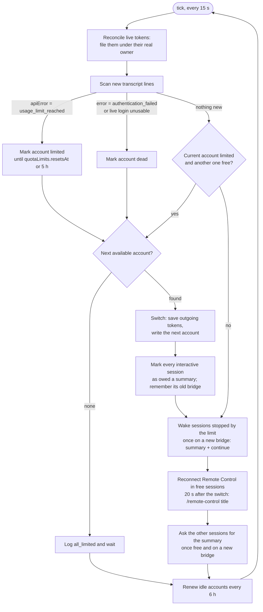
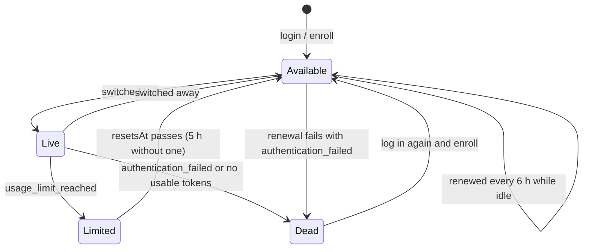

# claude-rotate

Switches Claude Code to another of your accounts when one hits its usage limit, nudges the stopped sessions to carry on, and keeps Remote Control alive across the switch.

A single Python file with no dependencies, running as a background watcher on Linux.

> **Read your plan's terms first.** claude-rotate only switches between accounts that you own and have logged into yourself. Whether using several subscriptions this way is allowed is governed by Anthropic's terms for your plan, and following them is your responsibility.

## The problem

When you have several Claude subscriptions (personal and work, or more than one seat), a usage limit still stops you cold:

- Every session in that config dir halts with `You've hit your limit · resets 9pm`.
- Getting going again means `/logout`, `/login` with another account in a browser, and then going back to each tmux pane to type "continue".
- Copying credential files between accounts by hand is fragile. Refresh tokens **rotate**: each refresh revokes the previous token. Restore a stale copy, or file a refreshed token under the wrong account, and that account is logged out until you log in again.
- An account you haven't used in a while can expire on its own, so it fails exactly when you rotate onto it.

## How it solves it

claude-rotate keeps a **vault** with one token slot per account and runs a watch loop every 15 seconds:

1. **Detects the limit.** It tails Claude Code's transcripts (`<config-dir>/projects/**/*.jsonl`, subagent transcripts included) for the synthetic error entry Claude Code writes when a request fails. It reads the entry's structured fields, never its text: `apiError == "usage_limit_reached"` is a usage limit and `quotaLimits.resetsAt` is when it resets; `error == "authentication_failed"` is an expired login. The account is marked limited until `resetsAt`, or for 5 hours if the entry has none. A short-lived 429 is not a quota limit and is ignored, and a reworded or translated message doesn't break detection.
2. **Switches.** It saves the outgoing account's live tokens to its slot, then writes the next available account (round-robin, skipping limited and dead ones) into the config dir's `.credentials.json` and `.claude.json`. Every other key in those files is left alone.
3. **Wakes sessions.** In every tmux pane whose last turn ended in that limit, it types a nudge that asks the session to write a short status summary (what it was doing, what is done, what is pending, the next step) and then continue where it stopped. The session picks up on the new account. Every other interactive session is asked for the same summary, without continuing, once its prompt is free (see [Remote Control and the status summary](#remote-control-and-the-status-summary)).
4. **Files every token under its real owner.** When the live tokens change (a session refreshed them, or a session still on the old account wrote its token), it asks the OAuth profile endpoint who owns the token and stores it in that account's slot. If the token belongs to a different account than the one the config dir should be on, it puts the right tokens back. If the owner can't be resolved, for example because there's no network, it writes nothing. It never guesses.
5. **Keeps idle accounts alive.** Every 6 hours, each enrolled account that isn't in use gets a one-word `claude -p` call. The call runs in a throwaway config dir, so the tokens refresh and get stored without touching your real one. A renewal that fails with `error == "authentication_failed"` in the throwaway dir's transcript marks the account dead; any other failure is reported as an error and retried later.
6. **Comes back.** When every account is limited, it logs `all_limited` and waits. As soon as one is free again, it switches and wakes the sessions.
7. **Optional: Remote Control.** If a config dir sets `"remoteControlAtStartup": true` in its `settings.json`, it re-runs `/remote-control <title>` in sessions that lost their bridge as soon as their prompt is free (idle, or only running background shells). If the bridge still doesn't come up, it restarts the session in the same pane with `claude --resume`.

### The watch loop



### The state of an account



`Live` is the account a config dir is on. A limited or dead account is skipped when choosing the next one.

## Remote Control and the status summary

A rotation changes the claude.ai account the machine is signed in to, so Claude Code drops every session's Remote Control bridge ("signed-in claude.ai account or organization changed"). A new bridge starts a new remote session with no history, so whoever follows the session from the phone or claude.ai would lose track of it. With `"remoteControlAtStartup": true`, claude-rotate:

1. **Waits for the old bridge to switch off.** For about 10 seconds after the switch, `/remote-control` only opens a "Remote Control isn't connected" dialog, so nothing is sent in the first 20 seconds.
2. **Reconnects free sessions only.** `/remote-control` is typed into a session whose prompt is free (idle or shell) and whose input box is empty; a draft you're typing is never touched. A busy session is left alone until its turn ends: typed into it, the command opens a dialog that stays open when the turn ends and blocks the session. A Remote Control dialog left open is closed on the next tick.
3. **Keeps the session's name.** The command carries the session's title, so the remote session shows the same name: the name you gave it (`/rename`, `--name`), else the latest title Claude Code generated for it (its `ai-title` entry). The name Claude Code derives from the directory (for example `yedran-81`) is never used. Titles are cleaned before they're typed: control characters and escapes are removed, whitespace is collapsed and they're cut to 80 characters.
4. **Moves bridges left on the old account.** Some Claude Code versions keep their bridge across the switch, so the session stays listed under the old account. Each `bridge-session` entry in the transcript names the account that registered it (`ownerAccountUuid`); when a free session's bridge belongs to another account than the one its config dir is on now, claude-rotate opens `/remote-control`, chooses "Disconnect this session", and step 2 registers it again under the current account.
5. **Asks for a status summary on the new bridge.** Every interactive session that was running at the switch writes a short status summary, so it's the first thing the new remote session shows. A session waits until its prompt is free and its bridge is a new one (the session registry still shows the old bridge for a few seconds after the switch). Sessions stopped by the limit then continue; the rest stop after the summary.

Everything is typed with tmux: Escape, a short pause (without it the terminal reads Escape and the first letter as an Alt key), the text, Enter. If the text is still in the input box after Enter, it presses Enter again, and if that doesn't send it either, it clears the box rather than leaving it there as a draft.

## Requirements

- **Linux.** It reads `/proc` to find the `claude` processes and the config dir each one runs with.
- **Python 3.10+** and **`pgrep`**.
- **tmux**, to wake sessions. Sessions outside tmux are switched but not woken (see Caveats).
- **Claude Code logged in with a claude.ai subscription (OAuth)**, which stores credentials in `<config-dir>/.credentials.json`. API-key logins have nothing to rotate.
- Network access to `api.anthropic.com` for the ownership check.

## Install

```bash
uv tool install git+https://github.com/DBC-Juanma/claude-rotate
# or
pipx install git+https://github.com/DBC-Juanma/claude-rotate
```

From a clone: `uv tool install .`

## Quick start

**1. Add each account.**

```bash
claude-rotate login
```

It opens the browser login. Sign in with the account and it's enrolled. `enroll` checks with the OAuth profile endpoint that the token really belongs to that account, and refuses otherwise. Repeat for every account. The account you are already logged into in `~/.claude` can be enrolled directly with `claude-rotate enroll`. Rotation follows the order you add accounts in.

**From inside Claude Code**, in a config dir claude-rotate watches (`~/.claude` by default): run `/login` with the account, then `! claude-rotate enroll`. The session switches to that account, which is the same state a rotation leaves it in.

Don't enroll from a config dir that claude-rotate doesn't watch while sessions run in it. The watcher treats that account as idle and renews it in its own throwaway dir, which rotates the refresh token and logs those sessions out.

**2. Check them.**

```bash
claude-rotate status    # which account each config dir is on, and the state of every account (never prints tokens)
claude-rotate check     # refresh every idle account now; exit code 1 if any is dead or failing
```

**3. Run the watcher as a systemd user service.**

```bash
curl -fsSLo ~/.config/systemd/user/claude-rotate.service \
  https://raw.githubusercontent.com/DBC-Juanma/claude-rotate/main/contrib/claude-rotate.service
systemctl --user daemon-reload
systemctl --user enable --now claude-rotate
journalctl --user -u claude-rotate -f
```

The unit runs `~/.local/bin/claude-rotate watch`, which is where `uv tool install` and pipx put the command by default. If yours is somewhere else, edit `ExecStart`.

**4. Optional: Remote Control in every session.** Add this to the config dir's `settings.json` (`~/.claude/settings.json`):

```json
{
  "remoteControlAtStartup": true
}
```

Every new session starts with Remote Control on. After a rotation, claude-rotate re-runs `/remote-control` in idle sessions that lost their bridge, and restarts with `claude --resume` any session whose bridge still doesn't come up.

**5. Work as usual inside tmux.** When a limit hits, the log shows `limit_hit` → `switch` → `rc_reconnected` → `woke` / `summary_asked`, and the panes continue on their own.

## Commands

| Command | What it does |
|---|---|
| `claude-rotate login [--email EMAIL]` | Log in to a new account in a throwaway config dir and enroll it |
| `claude-rotate enroll [--config-dir DIR]` | Snapshot the account logged in to `DIR` (default `$CLAUDE_CONFIG_DIR` or `~/.claude`) into the vault |
| `claude-rotate status` | Account per watched config dir; for every account: available / limited until / dead, and token expiry |
| `claude-rotate check` | Renew every idle account now |
| `claude-rotate use EMAIL [--config-dir DIR]` | Switch a config dir to an account by hand |
| `claude-rotate watch [--interval SECONDS]` | The watch loop (default 15s) |

## Configuration

State lives in `$XDG_CONFIG_HOME/claude-rotate` (default `~/.config/claude-rotate`). The directory is mode 0700 and every file in it is 0600.

| File | Contents |
|---|---|
| `config.json` | `config_dirs`: the config dirs to watch; `order`: the rotation order of enrolled emails |
| `accounts/<email>.json` | the vault: tokens and account info per account |
| `state.json` | limited-until times, dead accounts, last renewal, short post-switch guards |

To also watch a second config dir that you run in parallel, add it to `config_dirs`:

```json
{
  "config_dirs": ["/home/you/.claude", "/home/you/.claude-work"],
  "order": ["me@personal.com", "me@work.com", "me@other.com"]
}
```

Reorder `order` to change the rotation order. Edit the file while the watcher is stopped, or restart the watcher afterwards.

## Caveats

- **Outside tmux nothing types "continue" for you.** The account is still switched, but a session running in a plain terminal, an IDE or the desktop app stays stopped on the limit message until you type `continue` yourself.
- **The nudge is typed into the pane.** It waits while the input box holds a draft, but if you start typing in the same second it's sent, the two can mix. The nudge counts as a normal turn on the new account.
- **The summary costs quota.** Every interactive session writes one after every rotation, and each one re-reads that session's whole context on the new account, often with a cold cache. With many large sessions this takes a visible bite of the new account's limit.
- **Busy sessions reconnect late.** A session that stays busy (for example waiting on a long workflow) gets Remote Control back, and writes its summary, only when its turn ends.
- **Background sessions aren't reached.** Sessions the Claude Code daemon runs in the background have no tmux pane, so claude-rotate can't reconnect their Remote Control or ask them for a summary.
- **The generated title can be old.** A session you never named shows the title Claude Code generated for it, which can stay from an earlier topic. Give the session a name (`/rename`) to control what the remote session shows.
- **The switch applies to the whole config dir, not to one session.** Every session sharing a `CLAUDE_CONFIG_DIR` moves to the new account together. To keep accounts apart, use separate config dirs and add each one to `config_dirs`.
- **Never enroll the same login twice.** Two slots holding the same refresh-token family revoke each other the first time either one refreshes, and both end up logged out. Always enroll from a fresh login, never from a config dir that shares its login with another one.
- **Dead accounts stay dead until you fix them.** When an account's tokens are rejected, it's marked `DEAD` in `status` and skipped from then on. To bring it back, log in again in a temporary dir and re-run `enroll`.
- **It depends on Claude Code's transcript format.** Detection reads the `apiError`, `error` and `quotaLimits.resetsAt` fields of Claude Code's error entries, and Remote Control handling reads `<config-dir>/sessions/<pid>.json`. The message wording doesn't matter, but if a Claude Code update renames those fields, detection stops until the code is updated.
- **Detection isn't instant.** It polls every 15 seconds. Limit errors in the 90 seconds after a switch are treated as requests that were already in flight and ignored.
- **Renewal uses a bit of quota.** The idle renewal sends one tiny `claude -p` prompt per idle account every 6 hours.
- **Environment variables win.** Sessions started with `CLAUDE_CODE_OAUTH_TOKEN`, `ANTHROPIC_API_KEY` or `ANTHROPIC_AUTH_TOKEN` ignore the credentials file, so rotation does nothing for them.
- **Linux only.** On macOS, Claude Code keeps credentials in the Keychain rather than in `.credentials.json`.
- **Tokens are stored in plain text** (mode 0600), the same way Claude Code stores its own.
- **CPU on large histories.** Each tick lists every transcript in every watched config dir. With thousands of transcripts this costs a few minutes of CPU per day.

## Uninstall

```bash
systemctl --user disable --now claude-rotate
rm ~/.config/systemd/user/claude-rotate.service
uv tool uninstall claude-rotate          # or: pipx uninstall claude-rotate
rm -rf ~/.config/claude-rotate           # deletes the vault (all stored tokens)
```

Your config dirs stay logged in to whichever account was live at that moment.

## Development

```bash
uv run pytest
```

## License

MIT
